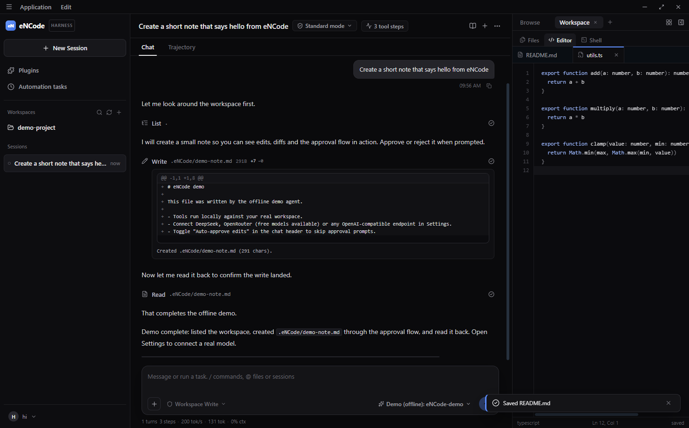

# eNCode

An AI-first desktop IDE with an autonomous coding agent. eNCode is built in this repository,
from the editor to the shell: it is not a VS Code fork and embeds no Monaco, xterm.js or
node-pty.



**Status:** private development, milestone M0 (foundation and security). Not released yet.
Windows is the primary platform; the code stays cross-platform.

## What it does

- **Agent-first workspace.** It has a sessions rail, a conversation with a tool timeline
  (Chat and Trajectory views), a composer with mode, approval-policy and model chips, and a
  Browse and Workspace rail with Files, Editor and Shell.
- **A coding agent with real tools.** The agent has these tools:
  - files: `glob`, `grep`, `read`, `edit`, `write`;
  - commands: `pwsh` (with background jobs: `job_list`, `job_output`, `job_kill`);
  - delegation: subagents through `task`;
  - planning: `todo_write`, goals, `exit_plan_mode`;
  - knowledge: `skill`, `web_search`, `web_fetch`;
  - questions: `ask_user_question`.

  It works in Code, Ask and Plan modes, and every session is persisted and can be forked.
- **Review before it acts.** Four approval policies decide what runs unasked:
  - Read Only: edits and commands are refused.
  - Workspace Write: every command asks.
  - Auto review: only provably read-only commands run unasked.
  - Full access: nothing asks.

  Approval cards say why they ask, and edits show their diff first.
- **Its own look.** Dark or light (or follow Windows), four accents, high contrast,
  compact density and reduced motion, under **Settings → Appearance**. The icons and the
  Trace N logo are drawn for eNCode, and Inter and JetBrains Mono are bundled.
- **Any model.** It works with any OpenAI-compatible endpoint and OpenRouter's catalog
  (including free models), with presets for DeepSeek, OpenAI, Ollama and LM Studio. Long
  sessions are compacted into a summary instead of failing at the context limit.
- **Hand-written internals.**
  - an editor engine and tokenizer;
  - the eNCode Shell (an interpreter, not cmd.exe or PowerShell);
  - an ANSI terminal buffer;
  - a Myers diff;
  - a markdown renderer and a state store.

## Quick start

Requires Node.js 22.12 or newer (24 recommended) and pnpm 10. `corepack enable` installs the
pnpm version pinned in `package.json`.

```bash
pnpm install
pnpm build
pnpm start
```

`pnpm dev` runs the renderer with hot reload and restarts Electron when the main process
changes.

Open a folder and start a session. The **Demo (offline)** profile needs no key: its plan is
scripted, but its tools act on the real workspace, so you can try approvals, diffs and the
shell straight away.

## Models

Open the profile menu at the bottom of the left rail and choose **Settings… → Models → Add
provider**, then pick a preset or *Custom*:

| Preset | Base URL | Example model |
| --- | --- | --- |
| OpenRouter | `https://openrouter.ai/api/v1` | pick from the catalog (`:free` models cost nothing) |
| DeepSeek | `https://api.deepseek.com` | `deepseek-chat` |
| OpenAI | `https://api.openai.com/v1` | `gpt-4o-mini` |
| Ollama | `http://localhost:11434/v1` | `llama3.2` |
| LM Studio | `http://localhost:1234/v1` | your loaded model |

An endpoint must implement `POST {baseUrl}/chat/completions` with OpenAI tool calling.
Streaming is preferred, and servers that answer with a single JSON body work too.

API keys are sealed by the operating system's keychain (DPAPI on Windows) and never written in
any other form. Where no keychain is usable, Settings says so and keeps the key for the
current session only. A key is bound to its server: pointing a profile at another server
drops it.

## The eNCode Shell

The terminal and the agent's `pwsh` tool share one hand-written shell. It supports
pipelines, `>` and `>>`, `;`, `&&`, `||`, quoting and its own built-ins (`ls`, `cat`, `echo`,
`cd`, `mkdir`, `cp`, `mv`, `rm`, `head`, `tail`, `wc`, `which`, `env`, `set`, …). Other
programs are found only in absolute `PATH` entries and started by absolute path. npm-style
`.cmd` shims run through cmd.exe only when their arguments are plain.

It is line-oriented, not a PTY, so full-screen programs such as vim and less are not
supported. The agent moves to the OS shell in M1
([ADR 0011](docs/adr/0011-agent-commands-run-in-the-os-shell.md)). The eNCode Shell stays
the terminal's shell.

## Shortcuts

| Action | Shortcut |
| --- | --- |
| Save the active file | `Ctrl+S` |
| Quick open | `Ctrl+P` |
| New session | `Ctrl+N` |
| Search across files | `Ctrl+Shift+F` |
| Toggle the right rail | `Ctrl+B` |
| Open the Shell | `` Ctrl+` `` |
| Find in file | `Ctrl+F` (in the editor) |

## Repository layout

```
apps/desktop/                 the Electron app (@encode/desktop)
  electron/                   main process: window, IPC, services, agent
    agent/                    loop, tools, approval, compaction, provider, prompt
    services/                 shell, workspace, settings and key vault, web, git, programs
  src/                        renderer: components, stores, editor, terminal, markdown
    theme/                    design tokens, appearance, bundled fonts and their licences
    styles/                   one stylesheet per area, in cascade order (index.css)
    ui/                       eNCode's icons, logo and shared controls
  shared/                     types and appearance rules shared by main, preload and renderer
  build/                      the app icon: icon.svg and the script that renders it
  scripts/                    build, dev, e2e harness, smoke, fake provider
  test/fixtures/              the workspace the smoke opens (copied, never edited)
packages/permissions/         shell grammar, command policy, egress and path rules
packages/testkit/             seeded property testing
docs/adr/                     architecture decision records
docs/security/                threat model
scripts/                      repository tooling: test runner, source checks
```

## Development

```bash
pnpm typecheck                # every package
pnpm test                     # unit tests (node:test); pnpm test shell compaction filters by path
pnpm build                    # renderer with Vite, main and preload with esbuild
pnpm e2e                      # the full smoke against the built app, in a throwaway sandbox
```

`pnpm e2e` copies `apps/desktop/test/fixtures/demo-project` to a temporary folder, gives
eNCode a temporary profile, and drives the real UI over the Chrome DevTools Protocol. The run
covers:

- the editor;
- the demo agent;
- the shell, running `node` and `npm`;
- a streaming provider (`scripts/fake-provider.mjs`) with approvals and diffs;
- the key path;
- sessions, subagents and Stop;
- web_fetch approvals;
- compaction.

Screenshots and the Electron log land in `apps/desktop/screenshots`. Set
`ENCODE_SMOKE_OFFLINE=1` to skip the one check that needs the internet.

CI runs all of the above on Windows for every pull request
([ADR 0012](docs/adr/0012-windows-first-ci.md)). Unit tests run in plain Node and may not
import Electron, so logic under test takes Electron APIs by injection.

## Security

The agent is treated as a confused deputy: whatever it decides to do passes an approval
policy, and content it reads is data, never instructions.

The [threat model](docs/security/threat-model.md) lists what is protected, how, and what
remains open. The decisions behind each control are in [docs/adr](docs/adr/README.md).

## Packaging

```bash
pnpm dist                     # -> apps/desktop/release/eNCode-<version>-portable.exe
```

Builds are unsigned until the release milestone (M6), which also adds installers,
auto-update and Electron fuses.

## License

MIT, see [LICENSE](LICENSE). The license for a public release is still to be confirmed.

The bundled fonts, Inter and JetBrains Mono, are under the SIL Open Font License 1.1; their
licences are in [apps/desktop/src/theme/fonts](apps/desktop/src/theme/fonts).
