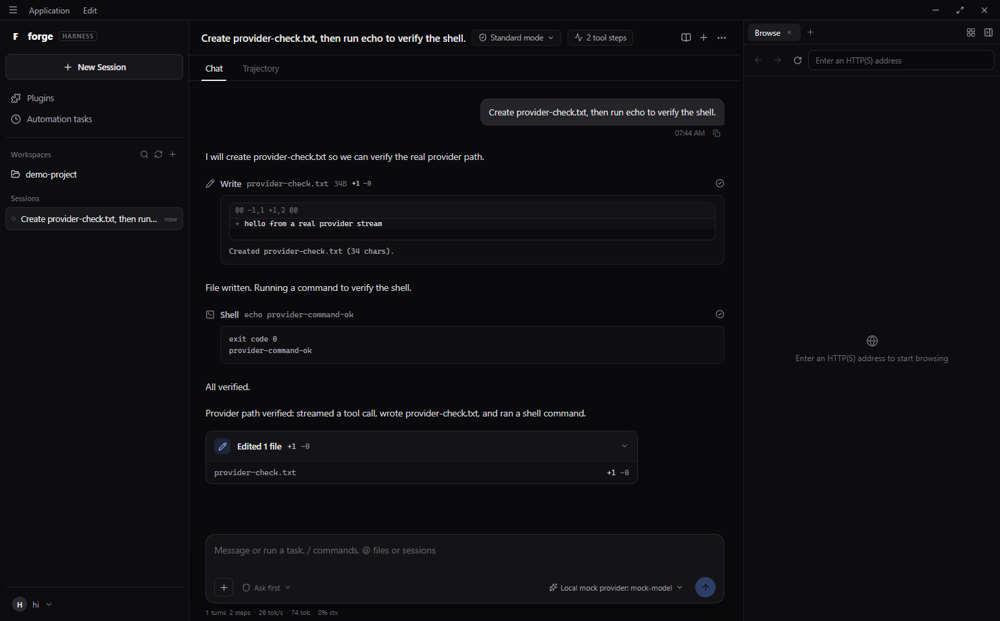
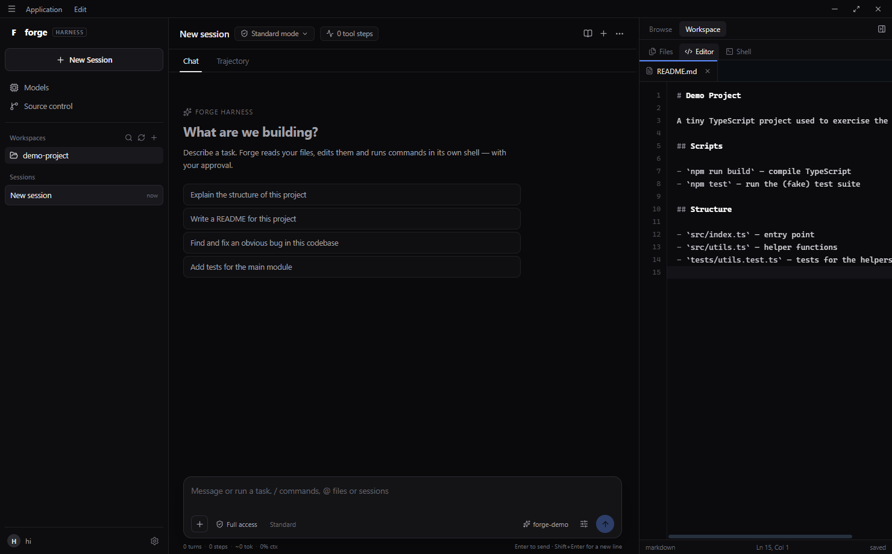

# eNCode

An AI-first desktop IDE with an autonomous coding agent — built from scratch, not a VS Code
fork.

eNCode pairs an agent-first interface (sessions rail, conversation with a tool timeline,
composer, browser/workspace rail) with a hand-written editor, shell interpreter, terminal
emulator and coding agent. It does not embed VS Code, Monaco, xterm.js, node-pty or the
`diff` package.


| Conversation | Workspace editor |
| --- | --- |
|  |  |

## Highlights

- **Agent-first UI** — full-width menu bar with Application/Edit menus and custom window
  controls, a monochrome palette with a single blue accent, a sessions/workspaces rail, a
  session header with mode and job chips, **Chat / Trajectory** views, a composer with
  approval policy and model chips, and a **Browse / Workspace** right rail.
- **Real sessions** — each session owns its own conversation, transcript and agent context.
  Create, switch, fork and delete sessions from the rail; every conversation is persisted to
  `userData/eNCode-sessions.json` and restored on launch, with the active session remembered.
- **Hand-written shell** — tokenizer, statement/pipeline parser, quoting, redirection
  (`>`, `>>`), `;`/`&&`/`||`, built-ins (`ls`, `cd`, `cat`, `echo`, `mkdir`, `rm`, `cp`,
  `mv`, `head`, `tail`, `wc`, `which`, `env`, `set`, …) and external program execution
  without cmd.exe or PowerShell. npm-style `.cmd` shims are resolved to their Node CLI.
- **Hand-written terminal** — an ANSI screen buffer with SGR colours, erase and cursor
  sequences, carriage-return progress output, history, tab completion and Ctrl+C/Ctrl+L.
- **Hand-written editor** — `textarea` engine over a highlighted overlay with a custom
  tokenizer (11+ languages), line-number gutter, current-line marker, in-file find,
  auto-indent, bracket pairing, block indent/outdent and per-file scroll memory.
- **Hand-written diff** — Myers line diff with unified hunks, used by the agent's diff
  previews and approval prompts.
- **Autonomous agent** — streaming tool-calling loop with `read_file`, `write_file`,
  `replace_in_file`, `list_files`, `search_files`, `run_command`,
  `ask_followup_question` and `attempt_completion`.
- **Review before it writes** — approval prompts with an inline diff preview; a single
  composer chip toggles *Full access* vs *Ask first*. Agent shell commands run inside the
  eNCode Shell, not a system shell.
- **Bring your own model** — any OpenAI-compatible chat-completions endpoint plus
  OpenRouter's catalogue (including free models), with DeepSeek/OpenAI/Ollama/LM Studio
  presets. Keys are encrypted with the OS keychain when available.
- **Workspace tools** — file explorer, tabs, dirty tracking, quick open, full-text search,
  source-control status, and a file/editor/shell drawer.

## From-scratch status

| Layer | Implementation |
| --- | --- |
| Editor + tokenizer | hand-written (`src/components/CodeEditor.tsx`, `src/editor/tokenize.ts`) |
| Shell interpreter | hand-written (`electron/services/shell.ts`) |
| Terminal emulator | hand-written (`src/terminal/buffer.ts`) |
| Diff | hand-written Myers diff (`electron/agent/diff.ts`) |
| Markdown rendering | hand-written (`src/markdown.ts`) |
| State store | hand-written external store (`src/store.ts`) |
| Agent, tools, prompt, provider | hand-written (`electron/agent/**`) |
| App UI | hand-written components (`src/components/**`) |
| Filesystem, search, git, settings, IPC | hand-written (`electron/services/**`, `electron/ipc.ts`) |
| Runtime | **Electron / Chromium / Node** — the platform boundary |
| Build toolchain | Vite, esbuild, TypeScript |

Still to be replaced before the "no app-level libraries" goal is complete: React and its
icon set (a React-free DOM renderer with inline SVG icons), and electron-builder packaging.
These are the next migration phases.

## Quick start

Requires Node.js 22.12+ (Node 24 recommended) and pnpm 10 (`corepack enable` picks the
version pinned in `package.json`).

```bash
pnpm install
pnpm build
pnpm start
```

Development with renderer HMR and automatic main-process restarts:

```bash
pnpm dev
```

Open a folder, then pick a model under **Models** in the left rail. The **Demo (offline)**
profile needs no key: its plan is scripted, but its tools operate on the real workspace, so
you can try approvals, diffs and the eNCode Shell immediately.

## Model setup

**Models → Add provider**, then choose a preset or *Custom*:

| Preset | Base URL | Example model |
| --- | --- | --- |
| DeepSeek | `https://api.deepseek.com` | `deepseek-chat` |
| OpenRouter | `https://openrouter.ai/api/v1` | pick from the fetched list (`:free` models are free) |
| Ollama | `http://localhost:11434/v1` | `llama3.2` |
| LM Studio | `http://localhost:1234/v1` | your loaded model |
| OpenAI | `https://api.openai.com/v1` | `gpt-4o-mini` |

Endpoints must implement `POST {baseUrl}/chat/completions` with streaming SSE and OpenAI
tool calling. eNCode retries once without streaming if a provider rejects it. Keys are
encrypted with Electron `safeStorage` (DPAPI on Windows) when available.

## Using eNCode

- **Chat** shows the live transcript; **Trajectory** shows every step with tool input and
  output.
- **Standard mode** can read, edit and execute. **Ask mode** is read-only and proposes
  changes instead of applying them.
- **Full access** auto-approves edits and commands. **Ask first** pauses before every write
  or command; file writes include a diff preview.
- **Browse** is an embedded browser tab (Enter an HTTP(S) address). **Workspace** holds the
  Files, Editor and Shell drawers.
- Opening a file from Files or Quick Open switches the right rail to the Editor. The Shell
  keeps its session while you switch drawers.
- **Stop** cancels the current request and kills its process tree.

### The eNCode Shell

The terminal and the agent's `run_command` use the same hand-written shell:

```text
ls -a
cat README.md | wc -l
echo hello > notes.txt
cd src && ls
node --version
```

Built-ins run in-process; other commands are resolved from `PATH` and spawned directly.
`Ctrl+C` cancels, `Ctrl+L` clears, `Up`/`Down` walk history, `Tab` completes files and
commands. npm-generated `.cmd` shims are detected and executed through `node` rather than
cmd.exe.

The shell is line-oriented rather than a full PTY: interactive TUI programs (vim, less,
full-screen apps) are not supported.

## Shortcuts

| Action | Shortcut |
| --- | --- |
| Save active file | `Ctrl+S` |
| Quick open file | `Ctrl+P` |
| New session | `Ctrl+N` |
| Search across files | `Ctrl+Shift+F` |
| Toggle right rail | `Ctrl+B` |
| Open Shell | `` Ctrl+` `` |
| Find in file | `Ctrl+F` (inside the editor) |
| Close quick open / dialogs | `Esc` |

## Architecture

```
electron/
  main.ts             app lifecycle, window, service wiring
  window.ts           frameless BrowserWindow + navigation hardening
  protocol.ts         app:// origin serving the built renderer
  preload.ts          contextBridge API (the only renderer↔main surface)
  ipc.ts              typed ipcMain handlers
  services/
    shell.ts          hand-written shell interpreter + session service
    workspace.ts      path-confined fs, search, recursive watcher
    settings.ts       settings + safeStorage encrypted keys
    models.ts         OpenRouter catalogue + provider model discovery
    git.ts            porcelain status parsing
  agent/
    agent.ts          tool-calling loop, approvals, cancellation, events
    manager.ts        per-session agents, persistence, fork/rename/remove
    provider.ts       streaming SSE + tool-delta accumulation, retry
    tools.ts          tool schemas, execution
    diff.ts           Myers line diff + unified hunks
    prompt.ts         system prompt
shared/types.ts       types shared across main / preload / renderer
src/
  markdown.ts         hand-written markdown renderer
  store.ts            hand-written external store (useSyncExternalStore)
  editor/tokenize.ts  dependency-free tokenizer
  terminal/buffer.ts  ANSI screen buffer
  components/CodeEditor.tsx  hand-built editor engine
  components/AppMenuBar.tsx / SessionRail.tsx / SessionHeader.tsx / RightPanel.tsx
  components/Chat/*   transcript, flat tool rows, diffs, approvals, composer
  stores/*            store modules built on src/store.ts
```

### Agent loop

1. Build a system prompt (mode, workspace root, top-level entries).
2. Stream a chat completion with tools and render deltas as they arrive.
3. Accumulate streamed tool-call deltas into complete calls.
4. For each call: optionally request approval (with a diff preview), execute it with
   validated, workspace-confined inputs, then append the tool result to the transcript.
5. Repeat until `attempt_completion`, a plain-text answer, cancellation or the step cap.

### Security model

- `contextIsolation: true`, `nodeIntegration: false`, no remote module, navigation and
  `window.open` are denied and external links open in the system browser.
- Renderer is served from a privileged `app://` origin with a CSP; the preload exposes a
  narrow, typed API. The browser tab is sandboxed and limited by `frame-src`.
- Every filesystem path is resolved against the workspace root, symlinks are realpath
  checked, and deletion is restricted to the root and uses the OS trash.
- Agent commands run through the eNCode Shell, only after approval unless auto-approved,
  with output caps and process-tree kill on timeout/cancel.
- API keys never cross into the renderer; the UI only learns whether a key exists.

## Development and testing

```bash
pnpm typecheck      # every package (renderer + main projects for the desktop app)
pnpm build          # Vite renderer + esbuild main/preload
pnpm dev            # HMR renderer, auto-restarting Electron
```

The end-to-end smoke test drives the real UI over the Chrome DevTools Protocol:

```bash
# terminal 1
pnpm start -- --remote-debugging-port=9222
# terminal 2
pnpm --filter @encode/desktop smoke ..\demo-project
```

It verifies the app shell, editor overlay text integrity, save round-trips, find,
quick open, tokenization, the offline demo agent, the eNCode Shell, and — with
`scripts/fake-provider.mjs` — the real streaming provider path including two approval
prompts, a rendered diff and shell execution. Screenshots are written to `screenshots/`.

`node scripts/fake-provider.mjs` runs standalone on `http://127.0.0.1:8787/v1`
(model `mock-model`) if you want to try eNCode without an API key.

## Packaging

```bash
pnpm dist           # -> apps/desktop/release/eNCode-<version>-portable.exe
```

`electron-builder.yml` currently defines Windows portable, macOS dmg and Linux AppImage
targets. Replacing electron-builder with a custom launcher/zip distribution is part of the
remaining from-scratch migration. Builds are unsigned unless you configure a certificate.

## Feature status

Implemented:

- Sessions: create / switch / fork / delete, persisted transcripts, remembered active session
- Goals: `create_goal` / `update_goal` (active, paused, complete, blocked), persisted per
  session, shown as a transcript card with pause/resume/edit/complete/delete, and
  auto-continuation rounds (capped at 8) while a goal is active
- Chat and Trajectory views, flat tool rows, inline diffs, edit-summary cards
- Approval prompts with diff previews; `Ask first` / `Full access` policy
- Standard (read · edit · run) and Ask (read-only) agent modes
- Composer stats: turns, steps, measured tok/s, tokens, context %
- Browse tab (sandboxed iframe) and Workspace drawers: Files, Editor, Shell
- Hand-written eNCode Shell, editor, search, quick open, git status
- Model providers: custom OpenAI-compatible, OpenRouter catalogue, DeepSeek/OpenAI/Ollama/LM Studio presets
- Offline demo agent for trying the loop without a key

Still to come (tracked in the goal for the next rounds):

- Todo list tool and panel
- Subagents and background jobs (spawn, poll, interrupt, collect)
- Scheduled tasks / reminders that fire prompts into a session
- Skills catalogue loaded from disk
- Plan mode (propose a plan, approve, then execute)
- `web_search` / `web_fetch` agent tools
- Provider usage accounting (total tokens, cache hit %) via `stream_options`
- Plugins page and automation-task management UI

## Limitations / roadmap

- Sessions persist to disk (last 50); there is no cross-workspace session scoping yet.
- The shell is line-oriented, not a PTY; full-screen TUI programs are unsupported.
- The Browse tab is an iframe and cannot display sites that forbid framing.
- No LSP or language servers; highlighting is tokenizer-based.
- Files larger than 300k characters render without syntax highlighting.
- Git integration is status-only. No split editors or extension API.
- Remaining third-party app libraries (React, Zustand, icons, markdown) are scheduled for
  hand-written replacements.

MIT licensed. See [LICENSE](LICENSE).
